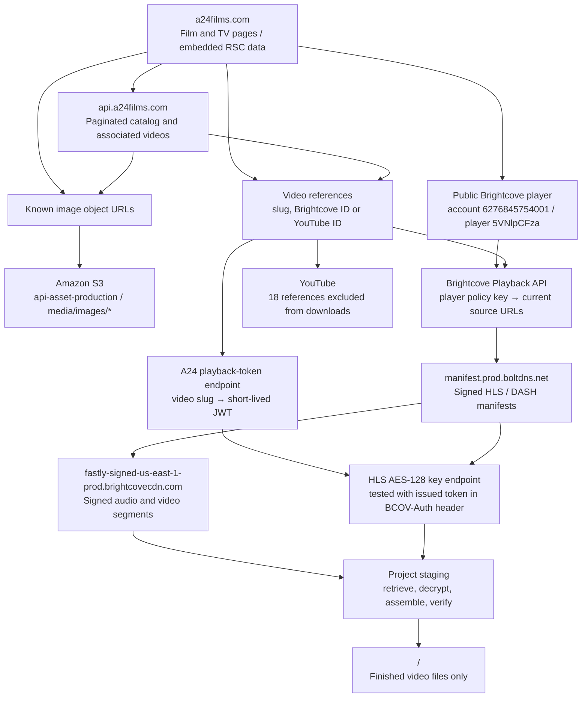

# A24 media inventory and downloader

This project documents A24's public media delivery and downloads its 333 catalog-linked Brightcove videos. Images and all 18 YouTube references are excluded at the user's request. Scripts, API evidence, schemas, logs, and intermediate downloads live here. Only finished video files go into the media directory. `<project>` means the checkout, and `<media-output>` defaults to `~/Media/a24` or the `A24_OUTPUT_DIR` environment variable:

```text
<project>/
├── README.md
├── AGENTS.md
├── api-routes/                # Observed API routes, requests, and access behavior
├── schemas/                   # JSON Schema for API responses and local inventories
├── harvest.py                # Catalog/page parsing and inventory generation
├── download_media.py         # Current video downloader
├── streams.py                # HLS inspection and batch helpers
├── authorize_keys.py         # Batch playback authorization helper
├── research-sources.md       # Supporting first-party research
├── reports/                  # Sanitized triage findings (published)
└── data/                     # Raw responses, inventories, status, and staging
    ├── titles.json
    ├── videos.json
    ├── assets.json
    ├── download-status.json
    └── staging/              # Playlists, keys, fragments, logs, partial video

<media-output>/
├── moonlight-trailer--6330628367112.mp4
└── ...                       # Finished Brightcove videos directly in this folder
```

## How A24 exposes its media

The diagram describes observed delivery paths. It does not establish where Brightcove stores its original masters, nor that A24's artwork bucket contains full films.



### What makes the objects retrievable

1. **Catalog enumeration:** unauthenticated JSON routes list film and TV entries using pagination. Title pages and associated-content responses disclose artwork URLs and video identifiers. These routes enumerate the public catalog, not every object in A24's infrastructure.
2. **Known S3 object reads:** the site directly supplies image URLs at `https://api-asset-production.s3.amazonaws.com/media/images/{object}`. The 701 inventoried image objects were initially downloaded and subsequently deleted at the user's request. Their URLs remain as research evidence; the downloader no longer downloads images. A public S3 `ListObjectsV2` request returned `AccessDenied`; knowing an image URL does not grant a bucket-wide inventory.
3. **Brightcove source discovery:** the site's public player contains its account ID, player ID, and player policy key. The Playback API uses that policy key to return current HLS and DASH sources for a known video ID. This key is player configuration, not AWS credentials or permission to list S3.
4. **Ordinary playback authorization:** A24 accepts a supplemental video's slug at its playback-token endpoint. Tested requests returned JWTs valid for about 60 seconds. HLS key retrieval without a token returned HTTP 401; a request with A24's issued token in `BCOV-Auth` returned the 16-byte AES key. The downloader uses that normal flow and fetches keys before the token expires.
5. **Signed CDN delivery:** Brightcove returns manifests and segment URLs with temporary signing parameters. A manifest describes renditions, audio tracks, segment locations, and encryption information; it is not a complete video file. The downloader chooses the highest-bandwidth AVC rendition exposed by the v1 HLS source, retrieves the matching audio, and remuxes them with FFmpeg.
6. **Separate YouTube videos:** all 18 YouTube-only references have been removed from the active queue, and the 14 successfully downloaded YouTube videos have been deleted. The historical references remain in `data/discovered-videos.json`. The downloader only processes Brightcove entries.

Brightcove's documentation describes [Playback API authentication and expiring URLs](https://apis.support.brightcove.com/playback/getting-started/overview-playback-api.html) and [playback restrictions/token handling](https://player.support.brightcove.com/playback/playback-restrictions-with-bcp.html). The routes actually observed here are documented in [api-routes](api-routes/README.md).

## Inventory and scope

Snapshot observed on **2026-11-10, America/Toronto**:

| Inventory | Count | Local evidence |
|---|---:|---|
| Film catalog entries | 145 | `data/catalog/a24-api-films*.json` |
| TV catalog entries | 52 | `data/catalog/a24-api-tv*.json` |
| Unique referenced image objects | 701 | `data/assets.json` |
| Originally discovered video references | 351 | `data/discovered-videos.json` |
| Active Brightcove download queue | 333 | `data/videos.json` |
| Excluded YouTube references | 18 | `data/discovered-videos.json` |
| Catalog-fetch errors after retries | 0 | `data/inventory-errors.json` |

Most references are trailers and supplemental content. One entry is labeled **Midsommar: Director's Cut** (Brightcove `6333140736112`, 10,213 seconds); its normal token request succeeded. Full-film availability for the rest of the catalog and complete TV episodes have **not** been established. Full-film actions can link to the separate [A24 App](https://app.a24films.com). There is no established whole-library export or publicly listable media bucket.

**Verified result as of 2026-11-11:** 327 files downloaded, totaling 253.01 GB; six DRM-only entries remain blocked. This includes no completed full-length Midsommar download. Details are in the [triage report](reports/failure-triage.md).

The 333 Brightcove entries total approximately **43.24 hours**. Their selected advertised bitrates imply approximately **292 GiB** of media; this is an estimate, not a downloaded-byte count. Consult `data/download-status.json` for per-video results. Only a successful download followed by ffprobe duration/stream validation is recorded as complete. Expected duration comes from current Brightcove metadata, since the website catalog can contain stale durations. See [failure triage](reports/failure-triage.md) for recovered mismatches and confirmed DRM-only entries.

## Running downloads

This public repository contains source code and documentation. The `data/` directory, downloaded media, tokens, keys, signed URLs, and runtime captures are excluded from Git. The scripts currently assume the saved local catalog/page captures and player configuration from the investigation; they are not a standalone fresh-clone crawler. `harvest.py catalog` prepares detail requests from captured catalog JSON, and `harvest.py inventory` parses the saved responses.

Requirements: Python 3, `curl`, `ffmpeg`, and `ffprobe`. The downloader reads the saved inventory and refreshes Brightcove source URLs for each item.

```bash
cd /path/to/a24

# Verify one video end to end.
python download_media.py --id 6330628367112 --workers 1

# Download the 333 Brightcove references, two at a time.
python download_media.py --workers 2

# Retry only failed entries; recover staged files after validation.
python download_media.py --failed-only --workers 2

# Inspect the current per-video state.
cat data/download-status.json

# Inspect logs from a previous local background queue.
tail -f data/download.log
cat data/download.pid
```

Completed files are verified and skipped on subsequent runs. Failed videos are recorded individually and are retried on a later run. Current FFmpeg transfers restart an unfinished video; they do not promise byte-level resume. A24 token requests are spaced at least 1.1 seconds apart. Failed HTTP requests remain visible in status. Images and YouTube videos are excluded, including when inventories are regenerated. DRM-protected sources are detected explicitly and reported as requiring a downloadable non-DRM rendition or source export. The runner does not obtain AWS credentials or enumerate other buckets.

`harvest.py` regenerates inventories from the raw catalog/page/associated-response files. Its generated curl batches are discovery helpers; signed source URLs can expire and must not be treated as permanent download links. `streams.py` and `authorize_keys.py` retain the earlier inspection/batch workflow; use `download_media.py` for the current end-to-end download path.

## Schemas and evidence

[schemas](schemas/README.md) distinguishes the API's observed payload shapes from the project's normalized inventories. These are schemas inferred from the captured responses, not a published A24 API guarantee. Optional fields and upstream changes should be handled accordingly. Raw responses are in `data/catalog/`, `data/associated/`, and `data/playback/`; the S3 listing denial is preserved in `data/s3-list-response.xml`.

Tokens, encryption keys, signed manifests, intermediate files, logs, and status stay under this project. The media output directory contains only finished Brightcove video files directly at its root, with no subdirectories.
